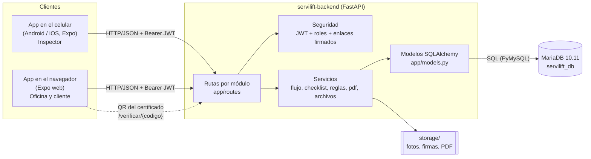
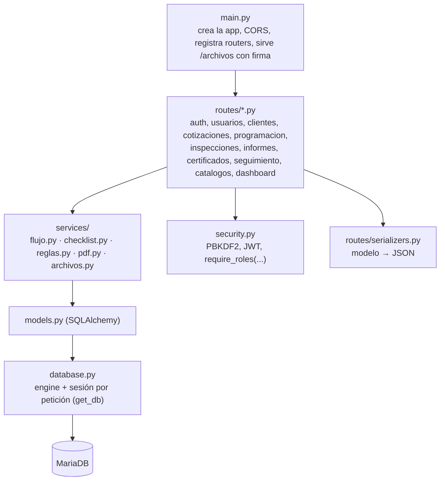
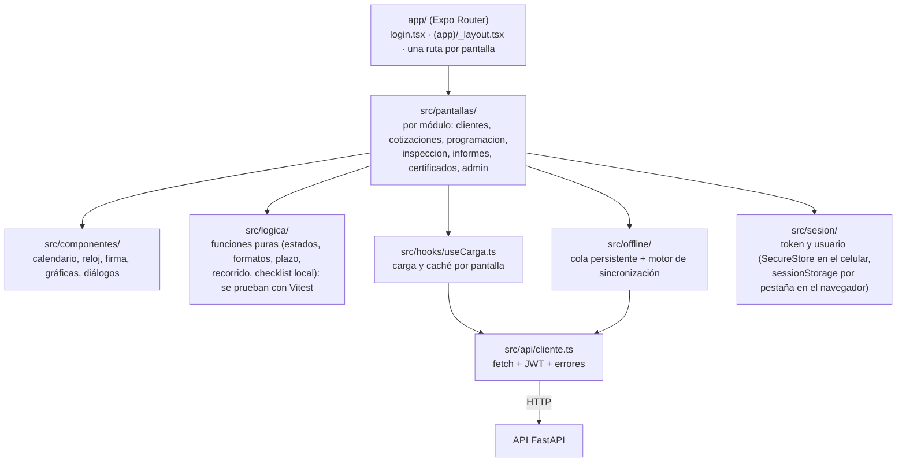
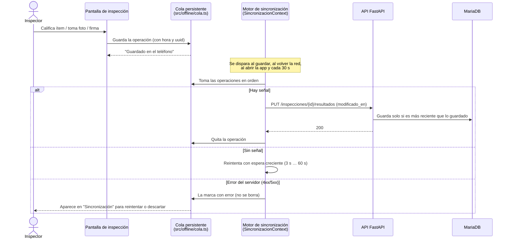
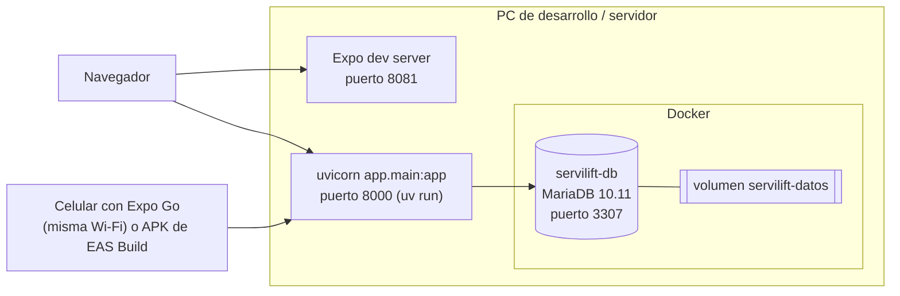

# Arquitectura

ServiLift es un sistema cliente-servidor de tres capas: una **app** React Native (Expo) que corre en el celular
del inspector y en el navegador del personal de oficina y del cliente, una **API REST** en FastAPI que concentra
las reglas de negocio, y una base de datos **MariaDB/MySQL**.

## 1. Vista de componentes

| Componente | Carpeta | Tecnología | Responsabilidad |
|---|---|---|---|
| App | `servilift-app/` | Expo SDK 57, React Native 0.86, TypeScript, Expo Router, React Native Paper | Interfaz por rol, cola sin conexión, captura de fotos y firmas |
| API | `servilift-backend/` | Python 3.13, FastAPI, SQLAlchemy 2, Pydantic 2, python-jose, ReportLab, Pillow | Reglas de negocio, permisos, máquina de estados, PDF y archivos |
| Base de datos | `database/` | MariaDB 10.11 (Docker) o MySQL de XAMPP; migraciones Alembic | Persistencia, integridad referencial, vistas de seguimiento y aplicabilidad |
| Pruebas E2E | `e2e/` | Playwright | Recorre la app web contra un backend y una base de pruebas |
| CI | `.github/workflows/tests.yml` | GitHub Actions | Unitarias de app y backend con umbral de cobertura en cada PR |

## 2. Backend por capas

- **Rutas** (`app/routes/`): un archivo por módulo de negocio, unos 80 endpoints en total. Cada endpoint declara
  qué roles lo pueden usar y recibe la sesión de base de datos por inyección de dependencias (`Depends(get_db)`).
  La documentación interactiva queda en `http://localhost:8000/docs` (Swagger) al encender el backend.
- **Servicios** (`app/services/`):
  - `flujo.py`: consecutivos (`COT-2026-0001`, `INS-…`, `INF-…`, `CER-…`), **máquina de estados por equipo**
    (`TRANSICIONES`), historial y notificaciones. Un cambio de estado no permitido responde `409`.
  - `checklist.py`: qué ítems de la norma aplican según las variantes del equipo, precarga de "no aplica",
    resumen de hallazgos y validaciones antes de finalizar.
  - `reglas.py`: reglas puras sin base de datos ni HTTP (por ejemplo, no programar en días pasados); se prueban
    como unidad.
  - `pdf.py`: informe con la estructura de la plantilla NTC 5926-1 y certificado con código QR (ReportLab).
  - `archivos.py`: guarda fotos (reducidas con Pillow), firmas y PDF bajo `STORAGE_DIR`; en la base solo va la
    ruta relativa.
- **Modelos** (`app/models.py`): mapeo de las tablas descritas en [modelo-de-datos.md](modelo-de-datos.md).
- **Configuración** (`app/config.py`): variables de entorno con `pydantic-settings` (ver [instalacion.md](instalacion.md)).
- **Tiempo** (`app/tiempo.py`): todas las fechas en hora de Colombia (UTC−5).

### Módulos de la API

| Prefijo | Módulo | Roles principales |
|---|---|---|
| `/auth` | Inicio de sesión, usuario actual, cambio de contraseña | Todos |
| `/usuarios` | Usuarios y firma del usuario | Administrador |
| `/clientes`, `/edificios`, `/equipos` | Clientes, edificios y equipos (ascensores) | Asesor, administrador |
| `/cotizaciones` | Cotizar, enviar al cliente, respuesta del cliente, enviar a programación, anular | Asesor, cliente |
| `/programacion` | Equipos por programar, visitas, reprogramar y cancelar | Programación |
| `/inspecciones` | Agenda, iniciar, datos, variantes, checklist, fotos, mediciones, firmas, validar, finalizar | Inspector |
| `/informes` | Revisión, vista previa, devolver, aprobar y firmar, PDF | Director técnico, cliente |
| `/certificados`, `/verificar` | Elaborar, enviar, anular, PDF y verificación pública por QR | Certificados, cliente, público |
| `/seguimiento`, `/dashboard` | Estado de cada equipo, historial, solicitar 2ª visita, indicadores | Todos según rol |
| `/catalogos`, `/instrumentos`, `/notificaciones` | Normas, variantes, checklist, parámetros, instrumentos, avisos | Administrador y todos |

## 3. App por capas

- **Rutas**: Expo Router usa la estructura de carpetas de `app/` como mapa de navegación. `(app)/_layout.tsx`
  protege todo lo que exige sesión y arma el menú según el rol.
- **Mismo código, dos plataformas**: los archivos `*.web.ts` (por ejemplo `almacen.web.ts`,
  `fotosLocales.web.ts`) reemplazan a su par nativo cuando la app corre en el navegador.
- **Lógica pura** en `src/logica/` separada de las pantallas para poder probarla sin dispositivo.

## 4. Trabajo sin señal (inspector)

El inspector trabaja en sótanos y cuartos de máquinas sin cobertura. La app guarda cada cambio primero en el
teléfono y lo envía cuando hay señal.

Garantías: la cola sobrevive a cerrar la app; los resultados viajan con su hora y **el cambio más reciente gana**;
fotos y firmas llevan `uuid_offline` y el servidor no las duplica si llegan dos veces; finalizar exige que la cola
de esa inspección esté vacía.

## 5. Seguridad

| Aspecto | Implementación |
|---|---|
| Contraseñas | PBKDF2-SHA256 con 600.000 iteraciones y sal aleatoria de 16 bytes, guardadas como BLOB (`security.py`, migración 0005) |
| Sesión | JWT HS256 de 12 h (`ACCESS_TOKEN_EXPIRE_MINUTES`); en el celular el token va en SecureStore |
| Autorización | Cada endpoint exige roles; el cliente solo ve sus cotizaciones, informes aprobados y certificados enviados |
| Archivos | Fotos y firmas solo con enlace firmado que vence (`/archivos/...?v=&f=`); no hay carpeta pública y se evita salir de `STORAGE_DIR` |
| PDF | Se descargan con token temporal (`/descargas/{token}`) |
| Certificado | Código QR que apunta a `/verificar/{codigo}` para comprobar su autenticidad |
| CORS | En desarrollo solo `localhost`; en producción los orígenes de `CORS_ORIGINS` |

> Es un proyecto académico: trae una `SECRET_KEY` de demostración y usuarios con contraseña `123456`. En un
> despliegue real se define `SECRET_KEY` en `.env` y se cambian las contraseñas.

## 6. Despliegue

- La base corre en Docker con `docker compose up -d`; la primera vez crea `servilift_db` y la base de pruebas
  `servilift_v2_prueba` con los scripts de `database/`.
- El backend se ejecuta con `uv run uvicorn …` sobre `0.0.0.0` para que el celular lo alcance en la red local.
- El instalador Android (.apk) se genera con EAS Build: `npx eas build -p android --profile preview`.

## 7. Decisiones de diseño

| Decisión | Motivo |
|---|---|
| Una sola app para celular y navegador (Expo) | Un solo código TypeScript para todos los roles |
| Estado por **equipo** y no por cotización | Una cotización puede cubrir varios ascensores que avanzan a ritmos distintos |
| Solo dos visitas por servicio | Así lo define el procedimiento de certificación; una 2ª visita no conforme cierra el servicio (`CERRADO_NO_CONFORME`) |
| Norma como tabla (`norma`) | Permite nuevas ediciones de la NTC 5926 y las partes 2 y 3 sin cambiar código |
| Aplicabilidad de ítems en una vista SQL | Las reglas de "no aplica" por variante quedan en datos y migraciones, no dispersas en el código |
| Cola local con "el más reciente gana" | Evita perder o duplicar trabajo de campo con señal intermitente |
| Docker para la base y uv para Python | Instalación repetible: misma versión de MariaDB y dependencias exactas de `uv.lock` |
