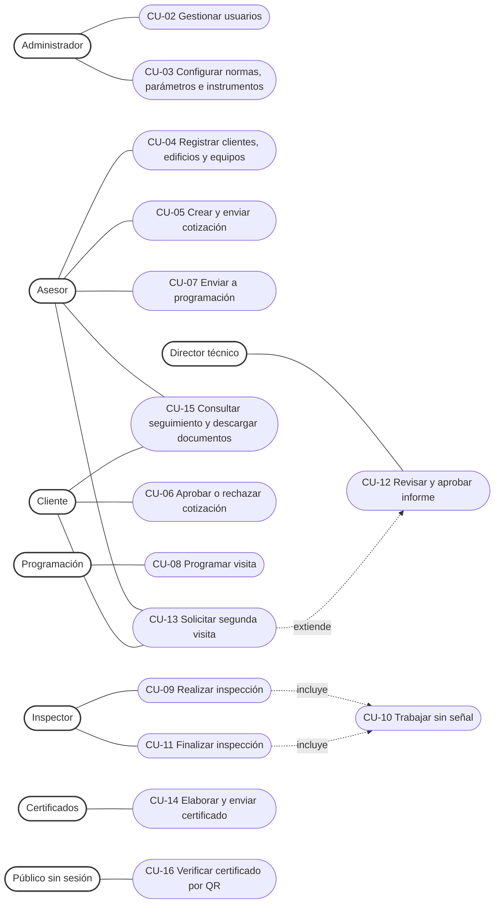
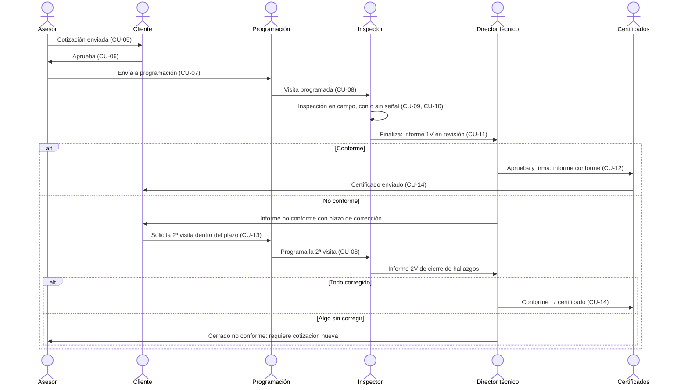

# Casos de uso

## 1. Actores

| Actor | Rol en el sistema | Dónde trabaja |
|---|---|---|
| Administrador | `ADMIN` | Navegador. Además de lo suyo, puede hacer cualquier acción de otro rol (`require_roles` siempre lo deja pasar) |
| Asesor comercial | `ASESOR` | Navegador |
| Cliente | `CLIENTE` | Navegador (portal) |
| Programación | `PROGRAMACION` | Navegador |
| Inspector | `INSPECTOR` | Celular, con o sin señal |
| Director técnico | `DIRECTOR_TECNICO` | Navegador |
| Certificados | `CERTIFICADOS` | Navegador |
| Público | Sin sesión | Cualquier dispositivo que lea el QR del certificado |

## 2. Diagrama de casos de uso

Todos los actores con sesión usan **CU-01 Iniciar sesión** y **CU-17 Recibir notificaciones**; se omiten las
líneas en el diagrama para que sea legible.

## 3. Flujo principal del negocio

## 4. Especificación de los casos de uso

### CU-01 Iniciar sesión
| | |
|---|---|
| Actores | Todos los roles |
| Precondición | El usuario existe y está `ACTIVO` |
| Flujo básico | 1. Ingresa correo y contraseña. 2. El sistema valida la contraseña (PBKDF2) y entrega un JWT de 12 h. 3. La app muestra el menú y el inicio de su rol |
| Alternos | Campos vacíos: la app no envía. Credenciales incorrectas: "Correo o contraseña incorrectos" (401). Usuario inactivo: 403. Sin servidor: "Sin conexión con el servidor" |
| Endpoints | `POST /auth/login`, `GET /auth/me` |
| Pruebas | E2E `login-exitoso`, `login-incorrecto`, `login-campos-vacios`, `cerrar-sesion`; unitarias `test_security.py`, `login.test.ts` |

### CU-04 Registrar clientes, edificios y equipos
| | |
|---|---|
| Actores | Asesor |
| Flujo básico | 1. Crea el cliente (tipo, documento, contacto). 2. Agrega edificios. 3. Agrega equipos uno a uno o genera varios de una vez (`/equipos/generar`). 4. Opcional: crea usuarios del portal para el cliente |
| Reglas | Identificación del equipo única dentro del edificio |
| Endpoints | `/clientes`, `/clientes/{id}/edificios`, `/edificios/{id}/equipos`, `/clientes/{id}/usuarios` |
| Pruebas | E2E `buscar-cliente` |

### CU-05 Crear y enviar cotización
| | |
|---|---|
| Actores | Asesor |
| Precondición | Edificio con equipos |
| Flujo básico | 1. Elige el edificio y *Nueva cotización*. 2. Marca equipos, valor y norma (por defecto la vigente). 3. *Enviar al cliente*: número `COT-AAAA-NNNN`, cada equipo queda `PENDIENTE_APROBACION` y se notifica al cliente |
| Alternos | Anular la cotización antes de que se ejecute |
| Endpoints | `POST /cotizaciones`, `PUT /cotizaciones/{id}`, `POST /cotizaciones/{id}/enviar-cliente`, `POST /cotizaciones/{id}/anular` |

### CU-06 Aprobar o rechazar cotización
| | |
|---|---|
| Actores | Cliente |
| Flujo básico | 1. Abre la cotización. 2. *Aprobar* (equipos a `APROBADO_CLIENTE`) o *Rechazar* (`RECHAZADO`). 3. Se notifica al asesor |
| Reglas | El cliente solo ve las cotizaciones de su propia empresa |
| Endpoint | `POST /cotizaciones/{id}/responder` |

### CU-07 Enviar a programación
| | |
|---|---|
| Actores | Asesor |
| Flujo básico | La cotización aprobada pasa a la bandeja de Programación (`POR_PROGRAMAR`) |
| Endpoint | `POST /cotizaciones/{id}/enviar-programacion` |

### CU-08 Programar visita
| | |
|---|---|
| Actores | Programación |
| Flujo básico | 1. Ve *Por programar* (incluye 2ª visitas solicitadas). 2. Elige inspector, fecha y hora en el calendario. 3. Los equipos pasan a `PROGRAMADO` y el inspector recibe la visita en su agenda |
| Reglas | No se programa en días pasados; la hora de fin debe ser posterior a la de inicio (`reglas.validar_horario`) |
| Alternos | Reprogramar o cancelar (el equipo vuelve a `POR_PROGRAMAR`) |
| Endpoints | `GET /programacion/pendientes`, `POST /programacion`, `PUT /programacion/{id}`, `POST /programacion/{id}/cancelar` |

### CU-09 Realizar inspección
| | |
|---|---|
| Actores | Inspector |
| Precondición | Visita programada para él; señal para abrirla la primera vez |
| Flujo básico | 1. En *Mi agenda* pulsa *Iniciar* (`INS-AAAA-NNNN`, equipo a `EN_INSPECCION`). 2. **Datos**: encabezado y datos técnicos (paradas, recorrido, foso). 3. Elige variantes: el sistema precarga como *No aplica* los ítems que no corresponden. 4. **Checklist**: califica cada ítem (Cumple / No cumple / No aplica) con medidas y observaciones. 5. **Fotos** de evidencia. 6. **Firmas** de inspector, técnico de mantenimiento y representante del edificio |
| Reglas | Calificar un ítem que no aplica al equipo pide confirmación; en la 2ª visita solo se revisan los hallazgos (Corregido / No corregido) |
| Endpoints | `/inspecciones/agenda`, `/inspecciones/iniciar`, `/{id}/encabezado`, `/{id}/equipo`, `/{id}/variantes`, `/{id}/resultados`, `/{id}/segunda-visita`, `/{id}/fotos`, `/{id}/mediciones`, `/{id}/instrumentos`, `/{id}/firmas` |
| Pruebas | Unitarias `test_checklist.py`, `test_reglas.py`, `checklistLocal.test.ts`, `recorrido.test.ts` |

### CU-10 Trabajar sin señal
| | |
|---|---|
| Actores | Inspector (incluido en CU-09 y CU-11) |
| Flujo básico | 1. Cada cambio se guarda primero en la cola del teléfono ("Guardado en el teléfono"). 2. Al haber señal la cola se envía sola, en orden. 3. La nube del encabezado muestra los pendientes |
| Alternos | Error del servidor: el cambio queda en *Sincronización* para reintentar o descartar |
| Reglas | El cambio más reciente gana; fotos y firmas no se duplican (uuid) |
| Detalle | Ver [arquitectura.md §4](arquitectura.md#4-trabajo-sin-señal-inspector) |

### CU-11 Finalizar inspección
| | |
|---|---|
| Actores | Inspector |
| Precondición | Con señal y sin cambios pendientes en la cola |
| Flujo básico | 1. *Finalizar*. 2. El sistema valida que todo esté completo. 3. Crea el informe `INF-AAAA-NNNN-1V` (o `-2V`) y el equipo pasa a `EN_REVISION`; se notifica al director |
| Alternos | Faltan datos: la app lista lo pendiente y abre la pestaña o el filtro correspondiente |
| Endpoints | `GET /inspecciones/{id}/validar`, `POST /inspecciones/{id}/finalizar` |

### CU-12 Revisar y aprobar informe
| | |
|---|---|
| Actores | Director técnico |
| Flujo básico | 1. Abre *Informes por revisar* y la vista previa del PDF. 2. *Aprobar, firmar y generar PDF*: el sistema congela los totales, firma, genera el PDF con su huella SHA-256 y lo publica al cliente |
| Resultado | 1ª visita conforme → `INFORME_APROBADO`. 1ª no conforme → `NO_CONFORME` con plazo de corrección. 2ª con todo corregido → `INFORME_APROBADO`. 2ª con algo sin corregir → `CERRADO_NO_CONFORME` |
| Reglas | Con no conformidades el concepto queda *No conforme* y no se puede cambiar |
| Alternos | *Devolver* al inspector con observaciones (vuelve a `EN_INSPECCION`) |
| Endpoints | `GET /informes`, `GET /informes/{id}/vista-previa`, `POST /informes/{id}/aprobar`, `POST /informes/{id}/devolver` |
| Pruebas | Unitarias `test_flujo_estados.py`, `estados.test.ts`, `plazo.test.ts` |

### CU-13 Solicitar segunda visita
| | |
|---|---|
| Actores | Cliente o asesor |
| Precondición | Equipo `NO_CONFORME` |
| Flujo básico | Solicita la 2ª visita; el equipo pasa a `SEGUNDA_VISITA_SOLICITADA` y aparece en la bandeja de Programación |
| Endpoint | `POST /seguimiento/equipo/{id}/solicitar-segunda-visita` |

### CU-14 Elaborar y enviar certificado
| | |
|---|---|
| Actores | Certificados |
| Precondición | Informe conforme (`INFORME_APROBADO`) |
| Flujo básico | 1. *Por elaborar* → *Elaborar certificado* (`CER-AAAA-NNNN`, PDF con QR). 2. *Certificados emitidos* → *Enviar*: el equipo pasa a `CERTIFICADO_LISTO` y el cliente lo descarga |
| Alternos | Anular un certificado con motivo |
| Endpoints | `GET /certificados/pendientes`, `POST /certificados`, `POST /certificados/{id}/enviar`, `POST /certificados/{id}/anular` |

### CU-15 Consultar seguimiento y descargar documentos
| | |
|---|---|
| Actores | Cliente, asesor y oficina |
| Flujo básico | Ve el estado de cada equipo, su historial y descarga informes (1V y 2V) y certificados con enlaces temporales |
| Endpoints | `GET /seguimiento`, `GET /seguimiento/equipo/{id}/historial`, `GET /informes/{id}/enlace-pdf`, `GET /certificados/{id}/enlace-pdf`, `GET /descargas/{token}` |

### CU-16 Verificar certificado por QR
| | |
|---|---|
| Actores | Público |
| Flujo básico | Escanea el QR del certificado y el sistema responde si está vigente, vencido o anulado, con su fecha de vencimiento |
| Endpoint | `GET /verificar/{codigo}` (sin sesión) |

### CU-02, CU-03 y CU-17 (administración y avisos)
| Caso | Descripción | Endpoints |
|---|---|---|
| CU-02 Gestionar usuarios | Crear y editar usuarios (estado activo, inactivo o bloqueado); cada usuario sube su firma | `/usuarios`, `PUT /usuarios/me/firma` |
| CU-03 Configurar | Normas y sus plazos, parámetros de la empresa (metros por parada, etc.) e instrumentos de medición | `/catalogos/normas`, `/catalogos/parametros/{clave}`, `/instrumentos` |
| CU-17 Notificaciones | Cada cambio relevante avisa al rol siguiente; el inicio muestra solo lo pendiente | `/notificaciones`, `PUT /notificaciones/leidas` |
