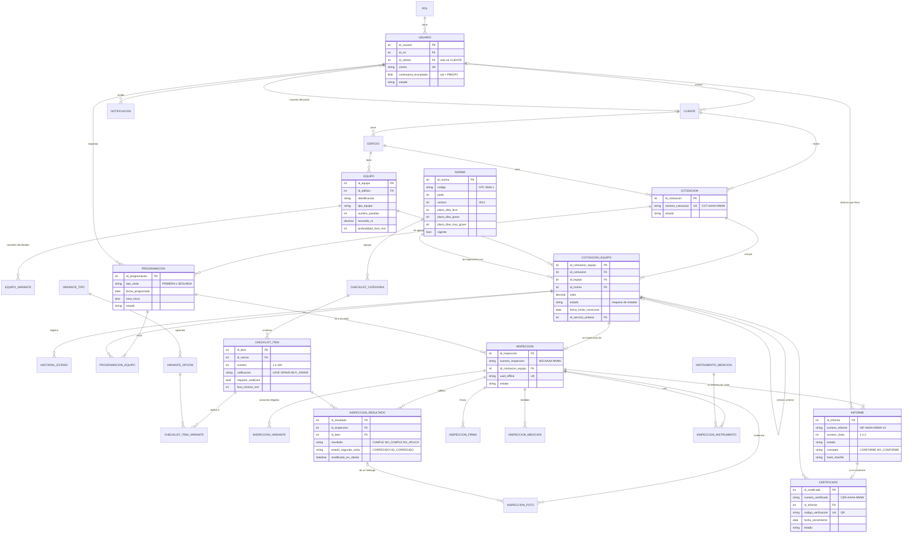
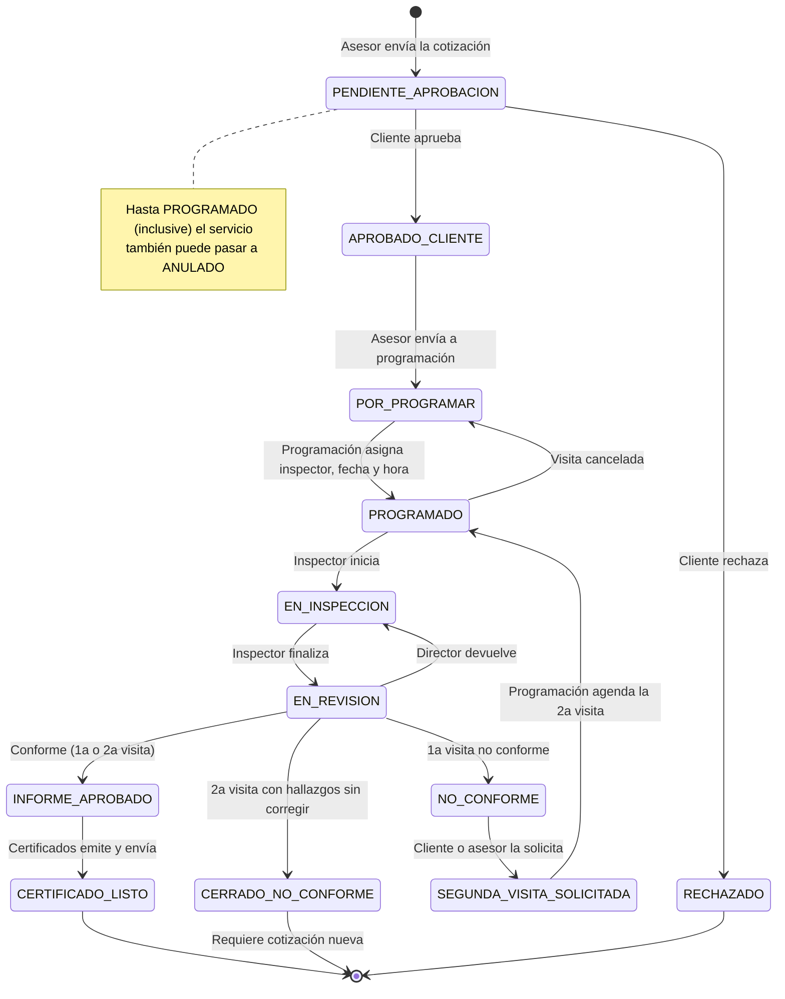

# Modelo de datos

Base `servilift_db` en MariaDB 10.11 / MySQL 8 (motor InnoDB, `utf8mb4`, fechas en hora de Colombia).
El script completo está en [`database/01_schema.sql`](../database/01_schema.sql); los cambios posteriores se
aplican con migraciones Alembic (`servilift-backend/alembic/versions/0001` a `0005`). En el backend cada tabla
tiene su modelo en `servilift-backend/app/models.py`.

## 1. Diagrama entidad-relación

Son 31 tablas (30 del negocio más `alembic_version`). Para no saturar el diagrama solo se muestran llaves y campos clave.

## 2. Diccionario de tablas

| Área | Tabla | Descripción |
|---|---|---|
| Seguridad | `rol` | Los 7 roles: ADMIN, ASESOR, CLIENTE, PROGRAMACION, INSPECTOR, DIRECTOR_TECNICO, CERTIFICADOS |
| | `usuario` | Usuarios internos y del cliente. Contraseña como BLOB (sal + PBKDF2-SHA256); `id_cliente` enlaza los usuarios del portal |
| Clientes | `cliente` | Persona o empresa (propiedad horizontal, empresa, persona natural, entidad pública) con su asesor |
| | `edificio` | Sedes del cliente |
| | `equipo` | Ascensores y montacargas con sus datos técnicos (paradas, recorrido, foso, capacidad) |
| | `equipo_variante` | Variantes declaradas del equipo (tracción/hidráulico, máquina, etc.) |
| Normas y checklist | `norma` | Parte y edición de la NTC 5926 con sus plazos de corrección; una sola vigente por parte (columna generada `vigente_parte` + índice único) |
| | `variante_tipo`, `variante_opcion` | Catálogo de variantes que filtran el checklist |
| | `checklist_categoria`, `checklist_item` | Ítems de la norma (169 en la NTC 5926-1:2012) con su calificación de defecto |
| | `checklist_item_variante` | Reglas de "no aplica": sin filas el ítem aplica siempre |
| Comercial | `consecutivo` | Último número por prefijo (COT, INS, INF, CER) y año; se bloquea con `SELECT … FOR UPDATE` |
| | `cotizacion` | Cotización a un edificio |
| | `cotizacion_equipo` | **Servicio**: un equipo dentro de una cotización, con su norma, valor, plazo y **estado** |
| | `historial_estado` | Cada cambio de estado del servicio con usuario, fecha y comentario |
| Programación | `programacion`, `programacion_equipo` | Visita (1ª o 2ª) con fecha, hora, inspector y los equipos que cubre |
| Inspección | `inspeccion` | Una por servicio; guarda la 1ª visita y la 2ª (cierre de hallazgos), encabezado y datos medidos |
| | `inspeccion_variante` | Variantes que eligió el inspector |
| | `inspeccion_resultado` | Calificación de cada ítem y, en la 2ª visita, si se corrigió; `modificado_en_cliente` resuelve conflictos sin señal |
| | `inspeccion_foto`, `inspeccion_firma` | Evidencias con `uuid_offline` para no duplicar reenvíos; firmas de inspector, técnico y representante |
| | `instrumento_medicion`, `inspeccion_instrumento`, `inspeccion_medicion` | Equipos de medición usados y medidas tomadas |
| Resultados | `informe` | Uno por visita (`-1V`, `-2V`) con concepto, atestación, firma del director, totales congelados, PDF y huella SHA-256 |
| | `certificado` | Emitido sobre un informe conforme, con vencimiento y código de verificación del QR |
| Sistema | `parametro` | Datos de la empresa y valores editables (metros por parada, etc.) |
| | `notificacion` | Avisos por usuario con enlace a la pantalla de la app |
| | `alembic_version` | Revisión de migraciones aplicada |

### Vistas

| Vista | Uso |
|---|---|
| `v_seguimiento_equipo` | Una fila por servicio con cliente, edificio, asesor y estado; alimenta Seguimiento y los filtros |
| `v_inspeccion_item_aplica` | Para cada inspección e ítem calcula si **aplica** según las variantes elegidas y la profundidad del foso |

## 3. Máquina de estados del servicio (`cotizacion_equipo.estado`)

Definida en `servilift-backend/app/services/flujo.py` (`TRANSICIONES`). Cualquier transición no listada responde
`409 Conflict` y cada cambio queda en `historial_estado`.

El plazo de corrección tras una 1ª visita no conforme es el menor entre los hallazgos: leve 180 días, grave 30,
muy grave inmediato (configurables por norma en la tabla `norma` o por ítem en `checklist_item.plazo_dias`).

## 4. Otros estados

| Entidad | Estados |
|---|---|
| `cotizacion` | BORRADOR, ENVIADA_CLIENTE, APROBADA_CLIENTE, RECHAZADA_CLIENTE, ENVIADA_PROGRAMACION, EN_EJECUCION, FINALIZADA, ANULADA |
| `programacion` | PROGRAMADA, REPROGRAMADA, EN_CURSO, REALIZADA, CANCELADA |
| `inspeccion` | EN_CURSO, FINALIZADA, DEVUELTA, APROBADA, EN_SEGUNDA_VISITA, CERRADA |
| `informe` | PENDIENTE_REVISION, DEVUELTO, APROBADO, ANULADO (concepto CONFORME / NO_CONFORME) |
| `certificado` | EN_ELABORACION, EMITIDO, ENVIADO_CLIENTE, ANULADO |

## 5. Migraciones

| Revisión | Cambio |
|---|---|
| `0001_v2_esquema_base` | Esquema v2 completo |
| `0002_reglas_no_aplica` | Reglas de "no aplica" por variante según la plantilla de informe 2012 |
| `0003_foso_minimo` | El ítem 12 no aplica con foso menor a 1500 mm |
| `0004_parametros_recorrido` | Metros por parada y sobre recorrido editables |
| `0005_contrasena_blob` | Contraseñas en BLOB con PBKDF2-SHA256 |

Una base creada antes se pone al día con `cd servilift-backend` y `uv run alembic upgrade head`.
