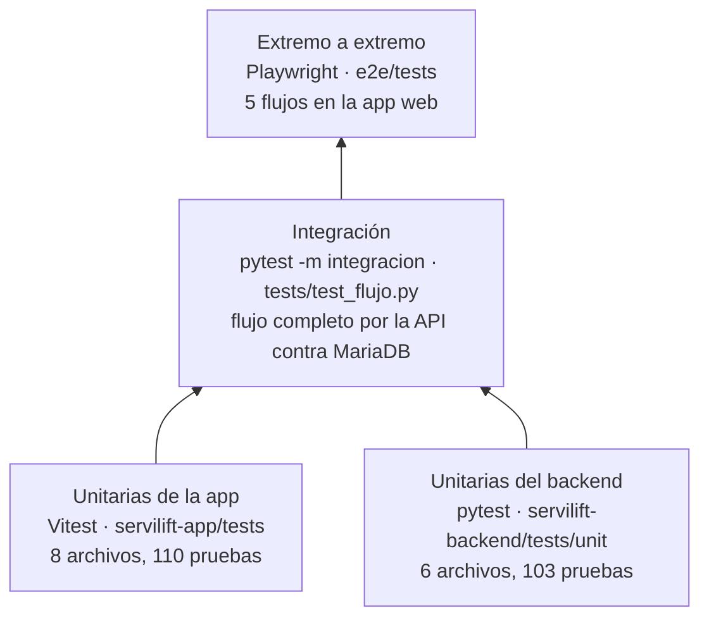

# Pruebas

ServiLift tiene cuatro niveles de prueba. Las unitarias corren sin base de datos ni red y son las que valida el
CI en cada pull request; la de integración y las E2E necesitan la base encendida.



*Cantidades medidas el 13/10/2026 en la rama `funcionalidad/docker-uv`.*

## 1. Resumen

| Nivel | Herramienta | Carpeta | Comando | Necesita |
|---|---|---|---|---|
| Unitarias app | Vitest + cobertura v8 | `servilift-app/tests` | `npm test` | Nada |
| Unitarias backend | pytest + pytest-cov | `servilift-backend/tests/unit` | `uv run pytest` | Nada |
| Integración | pytest + `TestClient` de FastAPI | `servilift-backend/tests/test_flujo.py` | `uv run pytest -m integracion --no-cov` con `DB_NAME=servilift_v2_prueba` | Base encendida |
| E2E | Playwright (Chromium) | `e2e/tests` | `pnpm test` | Base encendida |

## 2. Unitarias de la app (Vitest)

```bash
cd servilift-app
npm test              # corre todo y mide cobertura (falla si baja del umbral)
npm run test:watch    # modo observación mientras se programa
npm run typecheck     # verificación de tipos de TypeScript
```

Prueban la lógica pura de `src/logica/` y la cola sin conexión, sin React Native ni teléfono:

| Archivo | Qué verifica |
|---|---|
| `checklistLocal.test.ts` | Cálculo local del checklist (pendientes, hallazgos) |
| `estados.test.ts` | Texto y agrupación de los estados del servicio |
| `formatos.test.ts` | Fechas y horas en hora de Colombia, moneda |
| `login.test.ts` | Validación del formulario de ingreso |
| `notificaciones.test.ts` | A qué pantalla lleva cada notificación y cuáles siguen pendientes en el inicio |
| `plazo.test.ts` | Nivel del plazo de corrección (vencido, urgente, a tiempo) |
| `recorrido.test.ts` | Recorrido estimado por número de paradas |
| `tema.test.ts` | Color de cada estado y paleta de las gráficas |

El reporte HTML queda en `servilift-app/coverage/index.html`. Pantallas, componentes, contextos y adaptadores
(HTTP, almacenamiento) están excluidos de la medición por ahora; ver `vitest.config.mts`.

## 3. Unitarias del backend (pytest)

```bash
cd servilift-backend
uv run pytest                          # unitarias + cobertura (falla si baja del umbral)
uv run pytest tests/unit/test_reglas.py -v   # un archivo
uv run pytest -k plazo                 # por nombre
uv run pytest --cov-report=html        # reporte en htmlcov/index.html
```

`pyproject.toml` agrega por defecto `--cov` y `-m "not integracion"`, así que `uv run pytest` nunca toca la base.

| Archivo | Qué verifica |
|---|---|
| `test_security.py` | PBKDF2 en BLOB (sal distinta, tamaño, valores guardados inválidos), JWT, enlaces de descarga y de fotos firmados y su vencimiento |
| `test_flujo_estados.py` | Máquina de estados: transiciones permitidas y prohibidas |
| `test_checklist.py` | Aplicabilidad de ítems, resumen de hallazgos y validaciones para finalizar |
| `test_reglas.py` | Programación en días pasados, horario, plazo de corrección (el más estricto) |
| `test_notificaciones.py` | Destinatarios y vigencia de las notificaciones |
| `test_tiempo_config.py` | Hora de Colombia y validación de la configuración |

## 4. Integración

Recorre el negocio completo por la API contra una base real: un equipo con 1ª visita no conforme, 2ª visita
corregida y certificado; otro que termina `CERRADO_NO_CONFORME` y se vuelve a cotizar. Verifica además la
búsqueda, los enlaces firmados, el guardado idempotente y "el cambio más reciente gana".

```bash
docker compose up -d
cd servilift-backend
DB_NAME=servilift_v2_prueba uv run pytest -m integracion --no-cov
# PowerShell:  $env:DB_NAME="servilift_v2_prueba"; uv run pytest -m integracion --no-cov
```

Usa siempre la base `servilift_v2_prueba`, nunca `servilift_db`.

## 5. Extremo a extremo (Playwright)

```bash
cd e2e
pnpm install
pnpm exec playwright install chromium   # solo la primera vez
pnpm test          # corre los 5 flujos
pnpm test:ui       # modo visual paso a paso
pnpm report        # abre el último reporte HTML
```

Playwright levanta solo el backend (puerto **8010**, base `servilift_v2_prueba`) y la app web (puerto **8091**),
así no choca con el entorno del día a día (8000 y 8081). Variables opcionales: `API_PORT`, `FRONT_PORT`,
`DB_NAME`, `PYTHON`.

| Flujo | Archivo |
|---|---|
| Ingreso con credenciales válidas | `login-exitoso.spec.js` |
| Ingreso con contraseña incorrecta | `login-incorrecto.spec.js` |
| Formulario vacío | `login-campos-vacios.spec.js` |
| Búsqueda de clientes del asesor | `buscar-cliente.spec.js` |
| Cerrar sesión | `cerrar-sesion.spec.js` |

## 6. Cobertura y umbrales

Cada comando de unitarias falla si la cobertura baja del umbral configurado. El umbral solo puede subir semana a
semana (plan del bootcamp en [matriz-rotacion.md](matriz-rotacion.md)).

| Parte | Dónde se configura | Umbral actual | Medido el 13/10/2026 |
|---|---|---|---|
| App | `servilift-app/vitest.config.mts` | líneas 41 · ramas 61 · funciones 32 · sentencias 43 | líneas 42,4 · ramas 61,3 · funciones 34,6 · sentencias 43,9 |
| Backend | `servilift-backend/pyproject.toml` (`fail_under`) | 44 | 44,7 |

## 7. Integración continua

`.github/workflows/tests.yml` corre en cada pull request y en cada push a `main` y `version-2.1`:

| Job | Pasos |
|---|---|
| `frontend` | Node 22 → `npm ci` → `npm test`; sube el reporte de cobertura como artefacto (7 días) |
| `backend` | Python 3.13 → `uv sync --locked` → `uv run pytest` |
| `evidencia-individual` | Resume los commits de pruebas por autor en la semana |

La integración y las E2E se corren en local antes de fusionar (entran al CI más adelante en el plan).
